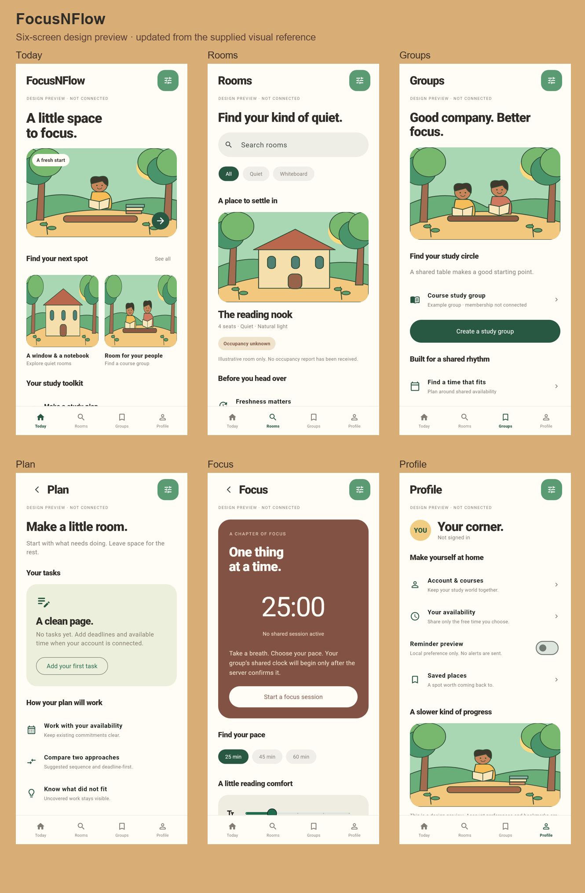

# FocusNFlow

Campus study organizer for Project 2, undergraduate track.

Team: Myles Miller (@ozemoya) and Eziz Bagshiyev (@ezizbagshiyev). Role assignments in the proposal are proposed responsibilities, not completed contributions.

## Current status

Planning and an explicitly labeled six-screen Flutter design preview. Firebase services, study scheduling, shared timers, notifications, evaluation, and release artifacts are **not implemented or verified yet**. The prototype never presents fictional cloud records as real results.

## Proposal and design

- [Proposal draft](docs/Proposal.md)
- [Word proposal draft](docs/FocusNFlow_Proposal_Draft.docx)
- [Six screen wireframes](design/wireframes.svg)
- [Requirements and acceptance criteria](docs/Requirements.md)
- [Architecture and security plan](docs/Architecture.md)
- [Dated task plan](docs/Plan.md)
- [Presentation and ownership plan](docs/Presentation.md)
- [AI transparency log](AI_Usage_Log.md)

Proposal due November 22, 2026 at 11:59 PM; final due December 13, 2026 at 11:59 PM, course local time. Signed individual statements and team review remain outstanding. No proposal has been submitted or approved for this project.

## Run the preview

Install Flutter, run `flutter pub get`, then `flutter run`. Use `flutter test` and `flutter analyze` for the current navigation checks. There are no credentials, Firebase project keys, or external API secrets in this starter.

## Product direction

Find a study room, coordinate a course group, schedule a conflict-free session, and share a timer across devices. Room occupancy in the initial course demonstration will use explicitly labeled synthetic service events, not claims about live campus sensors. The study helper will compare a bounded availability-aware heuristic against deadline-first ordering using fixed synthetic scenarios. No evaluation outcome is claimed before it is measured.

## Final delivery targets

The final README will link a tested APK, PowerPoint deck, and accessible 20–25 minute video. Both required topic questions FOC-U1 and FOC-U2, plus an owned lifecycle question for each presenter, must have working behavior, attributable history, and reproducible evidence. The final app must integrate Auth, Firestore, Storage, FCM, Cloud Functions, Remote Config, Analytics, and Crashlytics. App Check is optional.

## Visual preview

The six layouts now follow the supplied illustrated reference: cream surfaces, forest-green controls, warm brown focus panels and native vector study scenes. The overview uses actual Flutter renders; it is not an editable Figma design.

Local preview controls include the room-category chips, focus duration, text-size slider, reminders toggle and bookmark state. They do not create memberships, confirm occupancy, send notifications or start a cloud timer. Both navigation/control tests pass; narrow-screen navigation with enlarged text is covered. Static analysis reports no issues.
